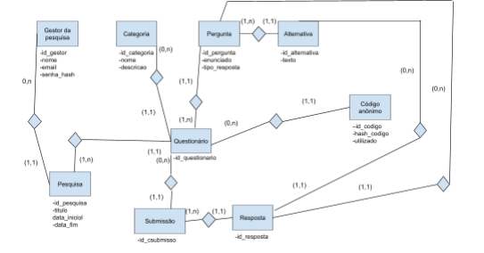

# Modelagem Conceitual

## Diagrama Entidade-Relacionamento

## Entidades

GESTOR, CATEGORIA, PERGUNTA, ALTERNATIVA, QUESTIONÁRIO, CÓDIGO_ANÔNIMO, PESQUISA, SUBMISSÃO e RESPOSTA.

> Observação: Aluno não é uma entidade porque entidade é aquilo que o banco de dados armazena, enquanto o sistema foi pensado para não identificar quem responde o questionário. Aluno é então um ator (que interage com o sistema).

## Mapeamento

- *Gestor:* *id_gestor, nome, e-mail, senha
- *Pesquisa:* *id_pesquisa, titulo, data_inicio, data_fim, --id_gestor
- *Categoria:* *id_categoria, nome, descricao
- *Questionário:* *id_questionario, --id_pesquisa, --id_categoria
- *Pergunta:* *id_pergunta, enunciado, tipo_resposta, --id_questionario
- *Alternativa:* *id_alternativa, texto, --id_pergunta
- *Participante:* *id_codigo, hash_codigo, utilizador (boolean), --id_questionario
- *Resposta:* *id_resposta, --id_pergunta, --id_alternativa