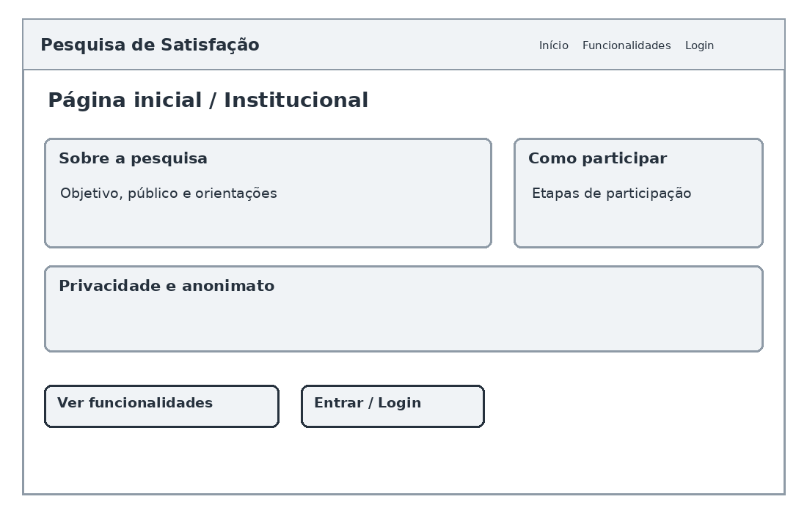

# Mapa do Site — Sistema de Gestão de Pesquisa de Satisfação

## Estrutura de Navegação

- Página inicial (Home)
  - Login / Acesso ao sistema
    - Área do gestor
      - Gerenciamento de pesquisas
      - Gerenciamento de categorias e perguntas
      - Geração de códigos anônimos
      - Acompanhamento da participação
      - Painel de resultados e relatórios
  - Acesso ao questionário
    - Validação do código anônimo
    - Formulário de pesquisa
    - Confirmação de envio

## Wireframes das Telas

### 1. Página inicial

### 2. Tela de Login

### 3. Formulário de Pesquisa

### 4. Painel de Resultados

