# Especificação da Modelagem UML

## 1. Diagramas de casos de uso

### 1.1 Cadastro de perguntas e alternativas

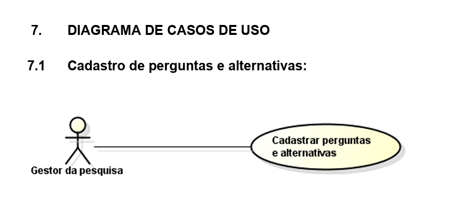

### 1.2 Gerar códigos anônimos de uso único

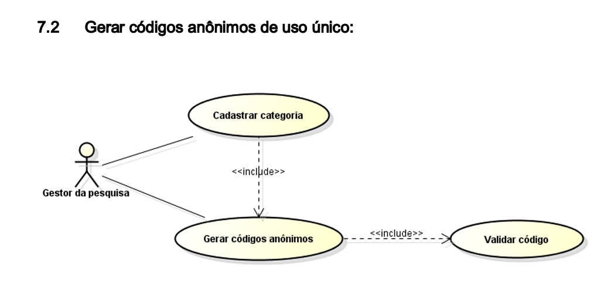

### 1.3 Acessar questionário

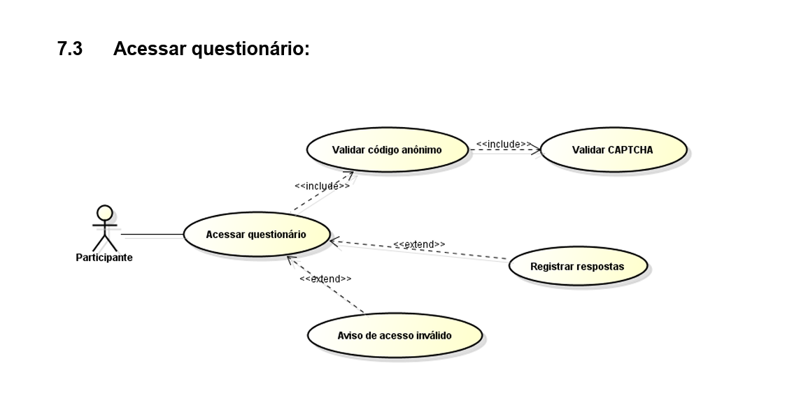

### 1.4 Monitorar participação em tempo real

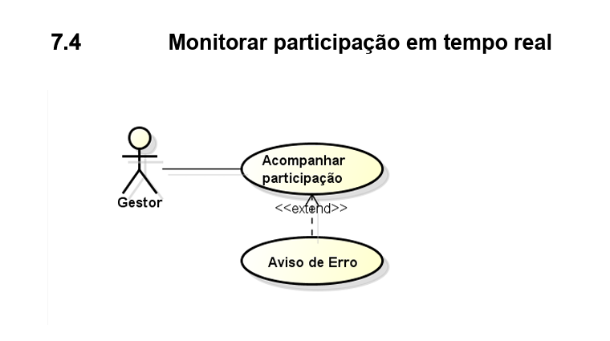

### 1.5 Criar relatórios estatísticos

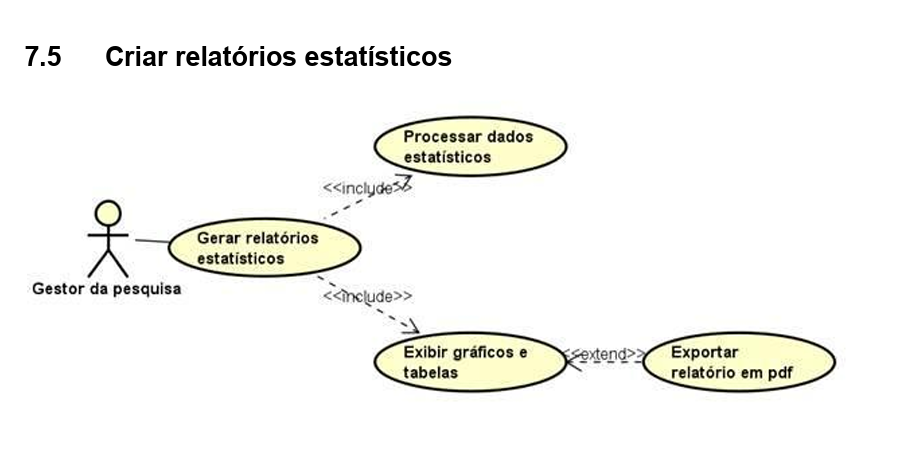

### 1.6 Manter categoria

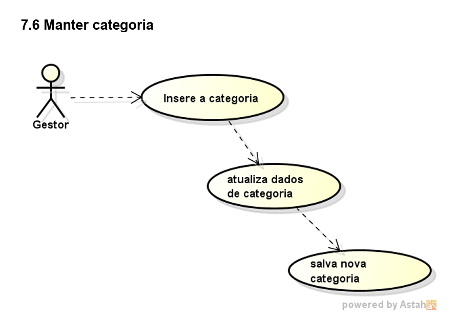

---

## 2. Fluxos principais e alternativos

### 2.1 Cadastro de perguntas e alternativas

*Fluxo principal*

1. O Gestor da pesquisa acessa a opção "Cadastrar Perguntas" no painel administrativo.
2. O Sistema carrega o formulário de cadastro com os campos de enunciado e tipo de resposta.
3. O Gestor digita a pergunta e escolhe a categoria à qual ela pertence.
4. O Gestor seleciona a opção "Adicionar Alternativa".
5. O Sistema exibe o campo para preenchimento da alternativa.
6. O Gestor digita o texto da alternativa.
7. O Gestor confirma a inclusão da pergunta e suas respectivas alternativas.
8. O Sistema valida se todos os campos obrigatórios estão preenchidos.
9. O Sistema salva os dados no banco de dados.
10. O Sistema exibe a mensagem "Pergunta cadastrada".
11. O Sistema retorna ao menu inicial.

*Fluxo alternativo*

1. O Sistema identifica que a pergunta está sem enunciado ou sem alternativas cadastradas.
2. O Sistema exibe a mensagem "Erro: Preencha o enunciado ou o cadastro da alternativa".
3. O Sistema retorna ao passo 3 do Fluxo Principal.

### 2.2 Gerar códigos anônimos de uso único

*Fluxo principal*

1. O gestor acessa a funcionalidade de geração de códigos anônimos.
2. O sistema solicita ou verifica a categoria vinculada ao código.
3. O sistema executa o caso de uso Cadastrar Categoria (caso a categoria ainda não esteja disponível).
4. O sistema gera um código anônimo, aleatório e de uso único.
5. O sistema verifica a unicidade e o formato do código gerado.
6. O sistema verifica se o código gerado atende aos critérios de segurança definidos.
7. O sistema disponibiliza o código válido ao participante sem registrar sua identidade.
8. O caso de uso é encerrado.

*Fluxo alternativo 1 - Categoria não cadastrada*

1. Durante a geração do código, o sistema identifica que a categoria não existe.
2. O sistema solicita o cadastro da categoria.
3. O gestor informa os dados da nova categoria.
4. O sistema registra a categoria.
5. O fluxo retorna ao passo de geração do código.

*Fluxo alternativo 2 - Código inválido ou duplicado*

1. Durante a validação, o sistema identifica que o código não atende aos critérios estabelecidos ou já existe.
2. O sistema descarta o código gerado.
3. O sistema gera automaticamente um novo código.
4. O sistema realiza novamente a validação.
5. O fluxo retorna ao passo de validação até que um código válido seja obtido.

### 2.3 Acessar questionário

*Fluxo principal*

1. O Participante acessa a página inicial do sistema de pesquisas.
2. O Sistema solicita o código anônimo de acesso e apresenta o CAPTCHA.
3. O Participante insere o código recebido, resolve o CAPTCHA e confirma.
4. O Sistema valida o hash do código no banco de dados, verifica o CAPTCHA e identifica a categoria vinculada ao código.
5. O Sistema carrega e exibe as perguntas e alternativas vinculadas àquela categoria.
6. O Participante responde às perguntas selecionando as alternativas desejadas.
7. O Participante clica em "Enviar Respostas".
8. O Sistema invalida o código utilizado para que não seja reutilizado e encerra a sessão de resposta.
9. O Sistema salva as respostas de forma totalmente anônima no banco de dados e exibe a mensagem "Respostas enviadas com sucesso!".
10. O Sistema retorna à tela inicial.

*Fluxo alternativo 1 - Código inválido ou já utilizado*

- 4.1. O Sistema identifica que o código digitado não existe ou já foi utilizado.
- 4.2. O Sistema exibe a mensagem: "Erro: código inválido ou já utilizado".
- 4.3. O Sistema registra apenas a data, a hora e o tipo da tentativa malsucedida, sem armazenar IP ou dados do dispositivo.
- 4.4. O Sistema limpa o campo de texto e retorna ao passo 2 do Fluxo Principal.

*Fluxo alternativo 2 - CAPTCHA inválido ou expirado*

- 5.1. O Sistema identifica que o CAPTCHA não foi validado ou expirou.
- 5.2. O Sistema exibe a mensagem: "CAPTCHA inválido. Tente novamente".
- 5.3. O Sistema gera um novo desafio CAPTCHA e retorna ao passo 2 do Fluxo Principal.

### 2.4 Monitorar participação em tempo real

*Fluxo principal*

1. O gestor acessa a opção "Acompanhar participação" no painel administrativo.
2. O sistema consulta os dados de participação da pesquisa.
3. O sistema mostra em tempo real a quantidade de pessoas que acessaram e concluíram a pesquisa.
4. O sistema exibe os dados de participação em tempo real no painel.
5. O gestor acompanha a atualização dos dados enquanto a pesquisa estiver em andamento.

*Fluxo alternativo - Falha na conexão com o banco de dados*

- 2.1. No passo 2 do Fluxo Principal, o Sistema identifica que não foi possível consultar os dados de participação.
- 2.2. O Sistema exibe a mensagem: "Erro: não foi possível atualizar os dados de participação. Tente novamente mais tarde."
- 2.3. O Gestor confirma a mensagem.
- 2.4. O Sistema mantém o painel aberto e permite uma nova tentativa de atualização.

### 2.5 Gerar relatórios estatísticos

*Fluxo principal*

1. O Gestor da pesquisa acessa a opção "Relatórios Estatísticos" no menu administrativo.
2. O sistema carrega a lista com todas as pesquisas institucionais cadastradas.
3. O Gestor seleciona a pesquisa desejada.
4. O Gestor seleciona a opção "Gerar Relatório por Categoria".
5. O sistema realiza a busca das respostas no banco de dados de forma totalmente anônima.
6. O sistema valida se a pesquisa possui dados consolidados suficientes.
7. O sistema processa os dados coletados e calcula as estatísticas.
8. O sistema exibe o formulário de visualização com os gráficos e tabelas dos resultados.
9. O Gestor seleciona a opção "Exportar em PDF".
10. O sistema realiza o download do documento para o dispositivo do gestor.
11. O sistema exibe a mensagem "Relatório exportado com sucesso!".

*Fluxo alternativo 1 - Sem dados*

- 6.2. O Sistema exibe a mensagem "Não há dados para gerar esse relatório".
- 6.3. O Gestor seleciona a opção "Ok".
- 6.4. O sistema retorna ao passo 2 do Fluxo Principal.

*Fluxo alternativo 2 - Falha de conectividade com o banco de dados*

- 5.2. O sistema identifica perda de conexão com o banco de dados e exibe a mensagem "Erro: Sistema temporariamente indisponível. Tente novamente mais tarde".
- 5.3. O Gestor seleciona a opção "Ok".
- 5.4. O sistema retorna ao menu inicial (passo 1 do Fluxo Principal).

### 2.6 Manter categorias

*Fluxo principal*

1. O Sistema exibe as categorias cadastradas.
2. O Gestor seleciona a opção "Cadastrar Categoria".
3. O Sistema exibe o formulário de cadastro.
4. O Gestor informa os dados da nova categoria.
5. O Gestor confirma o cadastro.
6. O Sistema verifica os dados inseridos.
7. O Sistema identifica que os dados são válidos.
8. O Sistema salva a nova categoria.
9. O Sistema informa que a categoria foi cadastrada com sucesso.
10. O fluxo é encerrado.

*Fluxo alternativo - Categoria ou dados inválidos (a partir do passo 7)*

1. O Sistema identifica que os dados informados são inválidos.
2. O Sistema informa "Categoria não encontrada".
3. O Sistema volta para a tela inicial para o gestor inserir as informações novamente.
4. O Gestor corrige os dados apontados pelo sistema.
5. O Sistema valida em banco de dados se os dados inseridos pelo gestor estão corretos.
6. O Sistema atualiza os dados no banco de dados com a nova categoria selecionada.
7. O fluxo é encerrado.
---

## 3. Diagramas de atividade

### 3.1 Cadastro de perguntas e alternativas

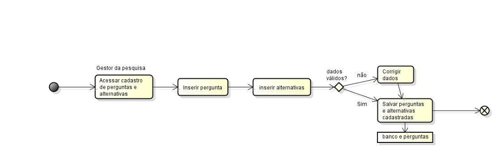

### 3.2 Gerar códigos anônimos de uso único

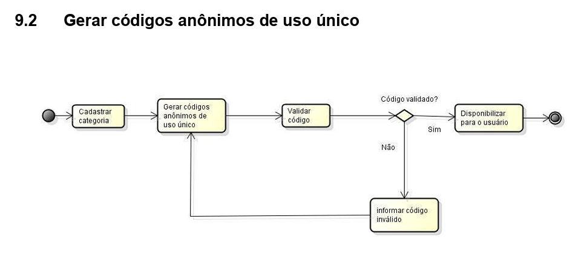

### 3.3 Acessar questionário

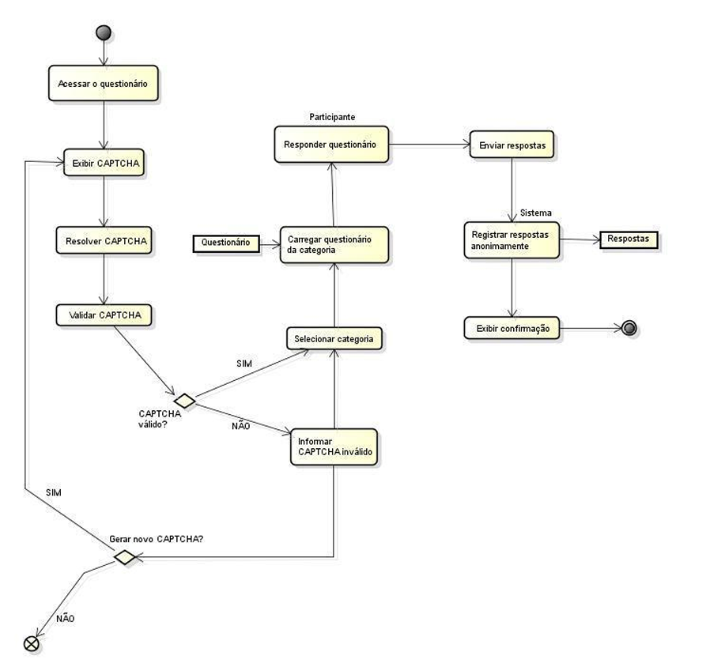

### 3.4 Monitorar participação em tempo real

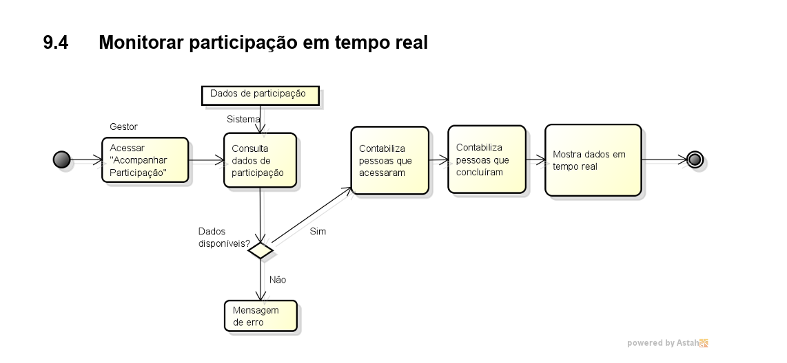

### 3.5 Criar relatórios estatísticos

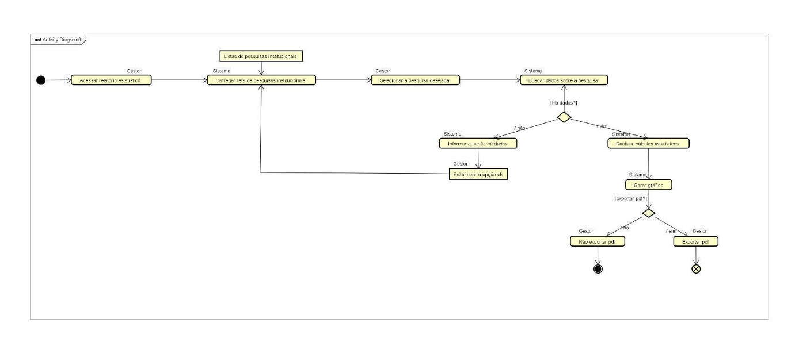

### 3.6 Manter categorias

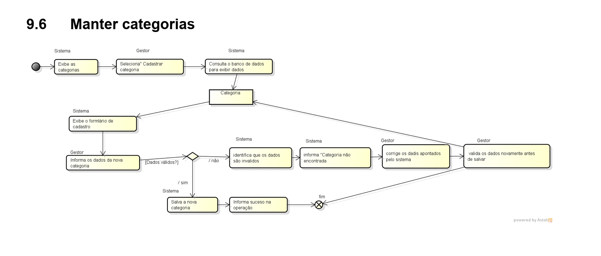